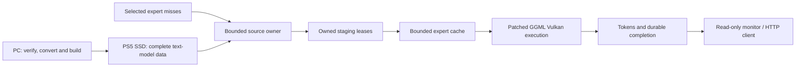

# Architecture

The console performs learned text-model inference. The PC authenticates and
prepares model data, cross-builds the app, transfers owned files and observes
results. The PC is not a learned inference fallback.

## Model and precision

Pinned llama.cpp `qwen4exp` supplies gated delta attention, QSA, hyper-connections,
PLE hashing/lookup and optional MTP paths. PLE and its exact I64 hash constants
are required, not replaced with zeros. Text generation is the qualified scope;
retaining vision/MTP data does not establish execution or a speed gain.

The original checkpoint is BF16. Original preparation changes layout/container
format while preserving the declared reference data. Later tested profiles
quantize weights and change application routing. The selected profile uses
Gate/Up Q2_K and Down Q2_0 MSE experts, quantized resident matrices, floating
activations and F32 KV/recurrent state. Keeping every expert on SSD does not
make those profiles original-BF16-equivalent. See
[current status](project-status.md) and [performance limits](performance.md).

## Data flow

This shows ownership/data flow, not measured GPU overlap. Demanded reads use
four lanes in existing 8 MiB scratch. A completed callback retains its lease
until its consumer returns. Known adjacent ranges can be coalesced; routing
does not become an all-expert SSD sweep. Banks, slot remapping and hit/miss
accounting build on the engine's expert-cache callback.

The original large file-mmap experiment is a historical failure. The qualified
reader lineage uses inaccessible virtual keys and bounded owned reads. Do not
treat the historical mapped-file design as an admitted native RAM tier. See
[source-reader evidence](reserved-source-20261024.md).

## Memory and completion

CPU/GPU allocations share physical backing. CPU buffers, filesystem residency,
staging, GPU weights and KV/state must be priced together. An application cache
limit is a policy, not total hardware capacity. SSD size/bandwidth alone does
not establish usable inference speed.

Identity and size gates precede allocation/publication. Workers, descriptors,
leases, GPU resources and request state have separate owners. Upload visibility
and completion must be positive before backing is released or the app is
ordinarily closed. Unknown completion retains ownership, not permission to retry.

R1 reuses a completed stage boundary. P1 narrows cold-prefill output selection
after the required trunk while preserving later request selection. These
mechanisms are distinct from optional experiments in `native/app/`. Complete
numerical/route qualification is separate from observer-free timing.

## Driver and frontend

Use [PS5-Vulkan-Inference](https://github.com/akiba-tokyo-jp/PS5-Vulkan-Inference)
at the selected source/profile in the
[dependency lock](../native/qwen_flash_next/dependencies.lock.json).
Measured lineage: `872cc126…` / `cumulative-idle`. Persistent caches stay off.
Unsupported BF16/cooperative/integer features cannot be inferred from a generic
API capability alone.

The frontend supplies actual allocator, lifecycle and static Vulkan dispatch
contracts. Engine libraries alone are not a runnable qualified app. Link,
imports, SELF integrity, memory admission, numerical acceptance and ordinary
close are separate gates. See [driver provenance](driver-integration.md) and
[native validation](native-validation.md).

One session owner drives generation. HTTP threads queue requests and stream
events; browser/TV monitors observe. Request resets and exact-prefix reuse are
explicit, different features. See [application and monitor](application.md).
